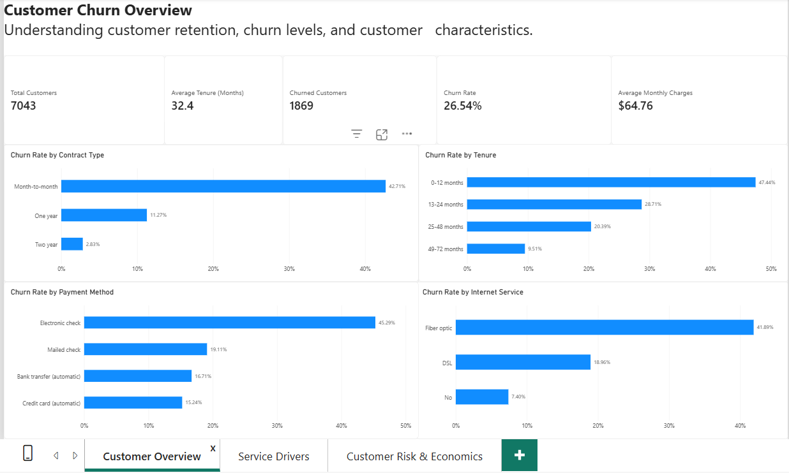
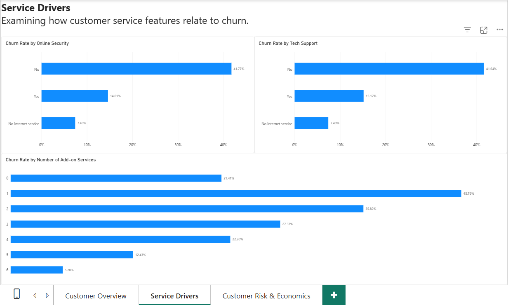
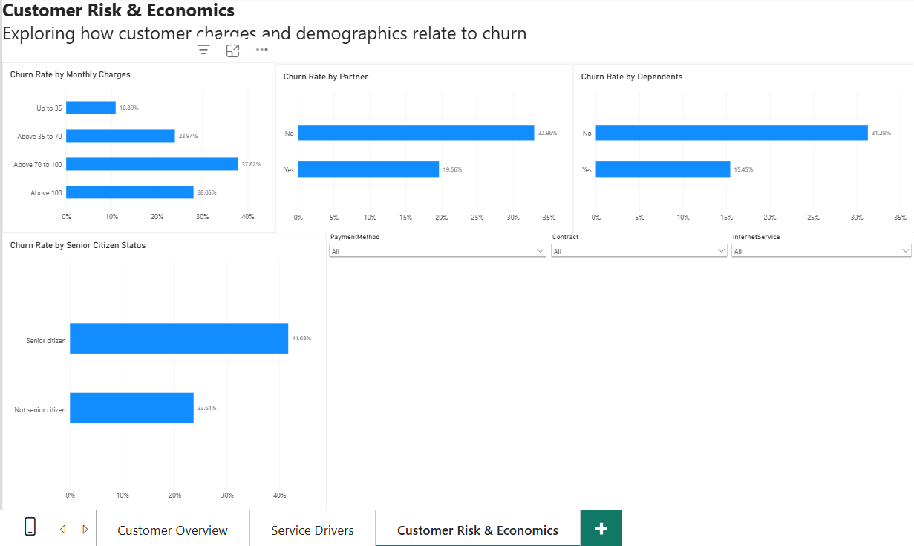

# Customer Churn & Retention Analysis

## About

This project explores why some customer groups leave a telecom service more often than others. I used Excel to audit the data, Python to clean and explore it, PostgreSQL to analyze churn patterns, and Power BI to build an interactive dashboard.

The analysis describes patterns and associations in the dataset. It does not prove that any one factor causes churn.

## Dashboard Preview

The Power BI report contains three pages. Screenshots are included below so visitors can preview the report directly on GitHub.

### 1. Customer Overview

Shows the overall customer KPIs and churn rates by contract type, tenure, internet service, and payment method.



### 2. Service Drivers

Compares churn rates by online security, technical support, and number of optional services.



### 3. Customer Risk & Economics

Explores churn across monthly-charge bands and demographic groups. It includes slicers for contract, payment method, and internet service.



## Project Objective

Identify customer groups with different observed churn rates and turn the results into useful questions for retention analysis.

## Dataset

- **Records:** 7,043 customers
- **Columns:** 21
- **Target field:** `Churn` (`Yes` / `No`)
- **Churned customers:** 1,869
- **Retained customers:** 5,174
- **Overall churn rate:** 26.54%

### Data Quality and Cleaning Decisions

- Audited row and column counts, duplicate customer IDs, blank values, category values, numeric ranges, and relationships between fields before cleaning.
- Found 11 blank or whitespace-only `TotalCharges` values. All 11 records had `tenure = 0` and `Churn = No`.
- Kept these values missing instead of replacing them with zero or deleting the customer records.
- Cleaned surrounding whitespace and converted `TotalCharges` to numeric in a separate processed dataset.
- Kept the raw CSV unchanged.
- Validated that the processed dataset contains 7,043 rows, 21 columns, and 7,043 unique customer IDs.

## Tools Used

- **Excel:** initial audit, missing-value review, category checks, numeric-range checks, and cross-field checks
- **Python:** pandas for reproducible cleaning and exploratory analysis; Matplotlib for charts
- **PostgreSQL:** grouped churn analysis, combined-segment analysis, customer profiles, add-on counts, charge analysis, and final validation
- **Power BI:** interactive reporting and DAX measures

## Key Findings

### Overall

- **26.54%** of customers churned.
- The dataset contains 1,869 churned customers and 5,174 retained customers.

### Contract Type

| Contract | Customers | Churned | Observed churn rate |
|---|---:|---:|---:|
| Month-to-month | 3,875 | 1,655 | **42.71%** |
| One year | 1,473 | 166 | 11.27% |
| Two year | 1,695 | 48 | 2.83% |

### Tenure

| Tenure band | Customers | Churned | Observed churn rate |
|---|---:|---:|---:|
| 0–12 months | 2,186 | 1,037 | **47.44%** |
| 13–24 months | 1,024 | 294 | 28.71% |
| 25–48 months | 1,594 | 325 | 20.39% |
| 49–72 months | 2,239 | 213 | 9.51% |

### Internet Service

| Internet service | Customers | Churned | Observed churn rate |
|---|---:|---:|---:|
| Fiber optic | 3,096 | 1,297 | **41.89%** |
| DSL | 2,421 | 459 | 18.96% |
| No internet service | 1,526 | 113 | 7.40% |

### Other Observed Patterns

- Customers without technical support had a 41.64% churn rate, compared with 15.17% for customers with support.
- Customers without online security had a 41.77% churn rate, compared with 14.61% for customers with online security.
- Electronic-check customers had a 45.29% churn rate, higher than the other recorded payment methods.
- The combined group of month-to-month contract and Fiber optic internet service had a 54.61% churn rate.
- Churn by monthly-charge band was not consistent: 10.89% up to 35, 23.94% above 35 to 70, 37.82% above 70 to 100, and 28.05% above 100.
- Customers with 0–6 optional services had observed churn rates of 21.41%, 45.76%, 35.82%, 27.37%, 22.30%, 12.43%, and 5.28%, respectively.

These are observed group-level associations, not proof of cause and effect. Contract type, tenure, service availability, charges, and customer characteristics may overlap and should be investigated together before recommending changes.

## Power BI Report

The report contains three pages:

1. **Customer Overview** — overall KPIs and churn by contract, tenure, internet service, and payment method.
2. **Service Drivers** — churn by online security, technical support, and add-on service count.
3. **Customer Risk & Economics** — churn by monthly-charge band and demographic characteristics, with slicers for contract, payment method, and internet service.

Core DAX measures include Total Customers, Churned Customers, Retained Customers, Churn Rate, Retention Rate, Average Monthly Charges, and Average Tenure.

## Repository Structure

```text
customer-churn-retention-analysis/
├── data/
│   ├── raw/
│   │   └── telco_customer_churn_raw.csv
│   ├── processed/
│   │   └── telco_customer_churn_clean.csv
│   └── telco_customer_churn_audit.xlsx
├── evidence/
│   ├── powerbi_screenshot/
│   │   ├── customer_overview.png
│   │   ├── service_drivers.png
│   │   └── customer_risk_economics.png
│   └── SQL and Python evidence images
├── python/
│   ├── 01_data_cleaning.py
│   └── 02_exploratory_analysis.py
├── sql/
│   └── numbered SQL analysis and validation scripts
├── reports/
│   └── python_eda/
│       ├── summary CSV files
│       └── charts/
├── screenshots/
│   ├── customer_overview.png
│   ├── service_drivers.png
│   └── customer_risk_economics.png
└── powerbi/
    └── customer_churn_retention.pbix
```

## How to Reproduce

1. Install Python and the required libraries:

   ```bash
   py -m pip install pandas matplotlib
   ```

2. From the project root, run the cleaning script:

   ```bash
   py python/01_data_cleaning.py
   ```

3. Run exploratory analysis:

   ```bash
   py python/02_exploratory_analysis.py
   ```

4. Create the PostgreSQL database and table using the included SQL setup scripts. Import `data/processed/telco_customer_churn_clean.csv`, then run the numbered analysis queries.
5. Open the Power BI file. If a refresh is required on another computer, update the CSV source path to the processed file in this repository.

## Limitations

- This is an observational dataset; relationships do not establish causation.
- The 11 missing `TotalCharges` values were retained as missing. Interpret analyses of total charges with this limitation in mind.
- Charge bands are analyst-defined categories for descriptive comparison, not official industry thresholds.
- No predictive churn model has been built as part of this project.

## Dataset Source

The dataset used in this project is available from the [IBM Telco Customer Churn dataset repository](https://github.com/IBM/telco-customer-churn-on-icp4d/blob/master/data/Telco-Customer-Churn.csv).
